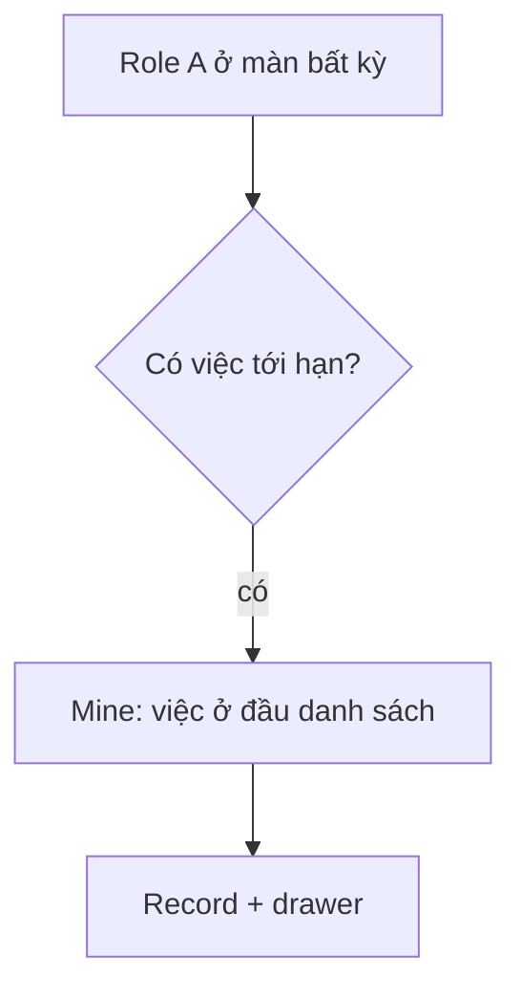

# Mẫu USER_FLOW — `features/<feature>/USER_FLOW.md`

```markdown
# <Feature> · User flow (Stage 3)

Tiếp nối mã flow cũ (nếu có). Đọc cùng PRD.md.

## 1. Shell và layout
- Vị trí trong điều hướng, route, layout theo pattern nào (cột danh sách → record có pill subnav → sidebar phải…).
- Phân cấp L0/L1/L2; header/toolbar; hành vi ở 1440 / 768 / 390.

## 2. Danh mục màn hình và trạng thái
| Mã | Màn / drawer | Role | Trạng thái cần có | Hành động chính |
|---|---|---|---|---|
| S1 | <Mine của role A> | A | Ready, Empty, Loading, No access, Error | <động từ> |
| D1 | <drawer> | A | … | … |
| M1 | <mobile 390> | … | … | … |

## 3. Đường vào (≤ 3 bước)
| Mã | Từ đâu | Các bước | Số bước | Đạt |
|---|---|---|---|---|
| E1 | Sidebar | Bấm "<Feature>" | 1 | ✓ |
| E2 | Thông báo | Bấm thông báo → record | 1 | ✓ |

## 4. Task (≤ 3 bước, tính từ màn <Feature> đang mở)
| Mã | Task | Bắt đầu | Các bước | Kết quả thấy được | Số bước |
|---|---|---|---|---|---|
| T1 | <đổi X> | S1, record đang mở | 1. Bấm "<CTA>" → D1  2. Chọn …  3. Bấm "<CTA chốt>" | <toast/trạng thái đổi> | 3 |
Ngoại lệ > 3 bước: ghi lý do + ngày người phụ trách duyệt.

## 5. Luồng chính


### A01. <Tên luồng>
1. …
2. …
```

Quy tắc:
- Đếm bước theo thao tác thật (bấm, chọn, gõ+gửi); mở modal/drawer là 1 bước khi thuộc task.
- Không "dời điểm bắt đầu" để giấu bước.
- Cùng task nhỏ ở feature khác → ghi tham chiếu pattern để giữ nhất quán.
