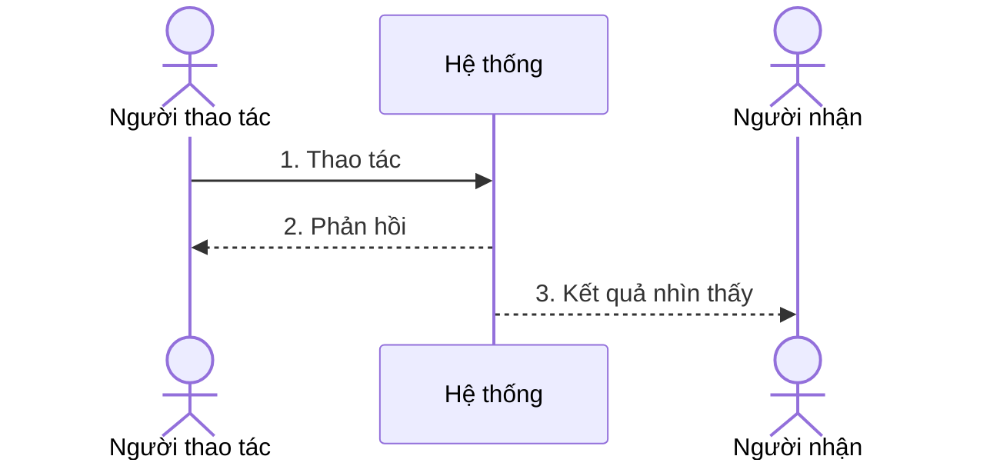

# <ID> · <tên kịch bản ngắn> · v<version>

Nguồn: <PRD/AC/quyết định>. Loại: nghiệp vụ/kỹ thuật. Người duyệt: PO/owner. Trạng thái: chờ duyệt.

**Bắt đầu:** <một câu về vai trò và trạng thái>.

**Kết quả đúng:** <một câu; bị chặn cũng có thể là kết quả đúng>.

**Duyệt:** Đúng / Sai / Hỏi lại. Mỗi phản hồi gắn ID, version, vai trò, ngày, lý do. Sửa kịch bản phải tăng version và duyệt lại.

Khi dựng trình xem tương tác: mỗi màn một kịch bản, chữ lớn, câu ngắn, bước trước/sau; không dùng màu làm tín hiệu duy nhất; kết quả duyệt phải xuất được thành bản ghi agent đọc được.
